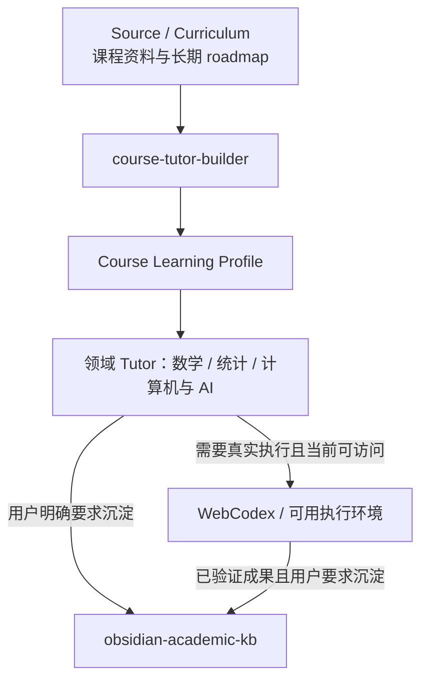

# Academic AI Learning System｜系统审计报告

审计日期：2026-09-27（日本时间）  
范围：当前已安装的五个 Skill、随附的跨账号交接说明、计算机学习路线压缩包。  
结论：五个 Skill 的职责和触发边界能够组合工作；**本次没有修改任何 Skill，也没有创建新 Skill**。需要处理的最小优化是澄清来源文件的权威关系和保存位置，而不是往 Skill 本体增加规则。

## 1. 当前最终 Skill 与职责图



| 已安装 Skill（界面名称） | 一句话职责 | 应触发的请求；不应误触发的请求 |
| --- | --- | --- |
| `course-tutor-builder`（课程导师生成器） | 读取具体课程资料和学习路线，生成或更新该课程的长期 Course Learning Profile。 | 请求生成课程专属导师配置、长期学习协议、路线转 Profile 时触发；仅引用 syllabus 来问一道题时不应重建 Profile。 |
| `rigorous-math-tutor`（严谨数学导师） | 处理定义、条件、量词、严格证明及数学结构的理解与检验。 | 独立数学证明、定理、数学计算和局部证明卡点；一般统计分析中的短推导由统计导师直接完成。 |
| `statistics-quant-lab`（统计与量化导师） | 审查数据、模型、推断、实验、预测与回测结论的可信范围。 | 估计与不确定性、因果、模型评价、泄漏、泛化、量化研究；纯数学证明或服务部署问题不由其主导。 |
| `computer-ai-tutor`（计算机与 AI 导师） | 解释和验证代码、运行机制、数据流、系统行为与 AI/ML 工程。 | 编程、Debug、算法、训练管线、服务、部署、性能及 AI 代码审查；统计结论与实验评价交由统计导师主导。 |
| `obsidian-academic-kb`（Obsidian 学术知识库助手） | 在明确要求时，把已理解、已验证的成果或标明待核查状态的草稿沉淀到 Vault。 | “导入 Obsidian”“存入知识库”“放入 Inbox”或操作 Vault 时触发；普通教学、证明、调试、课程规划均不因主题相关而触发。 |

这里的“主导”指一次请求的主要判断责任。跨领域问题应由一个主导者组织同一份回答，另一 Skill 仅提供必要的判断标准或执行细节；不机械拆成两次对话。

## 2. 边界与 Profile 的位置

| 相邻层 / 领域 | 归属判据 | 当前审计结论 |
| --- | --- | --- |
| Source → Profile | Source 决定原有路线、术语、项目和顺序；Builder 在忠于来源的前提下补学习深度、Evidence 与工具边界。 | Builder 本体及四份参考文件已明确来源分层、原生编号与 Stage 启用条件。 |
| Profile → Tutor | Profile 规定这门课现在学到哪里、允许的方法和阶段/项目约束；Tutor 决定怎样解释、练习、推理和验证。 | 三个 Tutor 都写明遵从现有 Profile，但普通问答不重建阶段或套固定栏目。没有 Profile 时不能编造进度。 |
| 数学 ↔ 统计 | 严格独立定理证明由数学主导；统计问题需要的简短期望、方差、导数或公式推导由统计就地完成。 | 当前描述和正文均支持此分界，没有每遇公式就 handoff 的要求。 |
| 统计 ↔ 计算机 / AI | 问“指标、实验、泄漏、泛化、结论能否成立”时统计主导；问“实现、管线、运行、服务、性能、Debug”时计算机主导。 | 同一 ML 问题可有一个主导者与必要协作，正文已有对应规则。 |
| Tutor / 执行环境 | Tutor 制定推理与验证方案；WebCodex Desktop + Secure Tunnel 在**当前确实有权限和可用连接**时访问本地文件、运行测试、模拟及项目修改。 | 不能由“存在 WebCodex”推断已看见用户机器、项目或 Vault；执行记录与尚未验证的猜测必须分开。 |
| Tutor / 执行结果 → Obsidian | 学懂与验证发生在相应 Tutor / 执行层；用户明确要求后才选择值得保存的结论、证据和链接。 | Obsidian 正文明确区分永久笔记、课程上下文、实验记录与 Inbox 快存。没有 Vault 访问时只能给可复制 Markdown，不声称已写入。 |

Course Learning Profile 是**课程级配置文件**，不是第六个 Skill，也不是每次回答的固定格式。它应保留 course identity、各来源的权威范围、原生顺序与阶段代码（若存在）、前置、深度策略、练习或项目、Evidence、必要的 Learning Debt、工具边界、复盘与 Obsidian 的显式导出行为。不断变化的“当前进度 / 本周任务 / 已完成证据”应放在进度记录，而不是每次重写长期 Profile。

## 3. 长期计算机 roadmap 的实物核查

压缩包中当前总路线为《学习路线v5.4.3_AI全栈防浅学习执行版_版本同步修正版.md》；配套有单阶段生成器 v2.3.1、阶段内任务生成器 v1.3、使用手册，以及置于“提示词体系过时”目录的旧版本。总路线第 5–10 节和附录 A/B 给出原生结构；程序检查第 6 节阶段表，**P00–P31 共 32 行，顺序完整、没有缺号或重复**。

- A 基础建设 P00–P03；B 数据能力 P04–P08；C 机器学习 P09–P11；D AI 工程与全栈闭环 P12–P21；E 深度学习与大模型 P22–P29；F 科研、作品集与读研准备 P30–P31。
- P07、P11、P19、P27 等为条件支线；P20、P21、P28 等具有后期可选或条件性质。阶段代码存在不等于全部必须完成，也不等于一阶段只能一轮。
- 第 7 节及手册规定支线归属和激活时机；第 8 节有阶段闸门；第 10 节有四类锚点项目（P01–P03 Python 工具、P04–P08 数据分析、P09–P10 ML、P15–P29 AI 全栈 / RAG / LLM eval）；附录 A 有各阶段的前置、项目与完成标准。
- 总路线第 3 节把“个人复盘说明手册”列为五件套之一；本次压缩包的**当前文件区域未包含其现行版**，只有“提示词体系过时”目录中的历史复盘手册。历史手册明确包含学习债务台账和证据索引，证明这些机制曾属于该路线；但不能把旧台账的状态冒充现在的 Learning Debt。Profile 可保留“必要且暂缓才记录、到触发点回收”的原则，实时债务须由当前记录确认。
- 这套材料是**这条路线的长期 curriculum / source of truth**。由 `course-tutor-builder` 编译出 *Long-term Computer Science Course Learning Profile* 后，再由 `computer-ai-tutor` 负责具体学习和工程理解。统计评价或严格证明按问题本身选择主导者。WebCodex 负责可访问项目的真实执行，Obsidian 仅在明确请求时沉淀成果。

交接说明第 8 节写有“不要继承……固定 P00–P31”，是历史迁移建议。结合当前用户要求、总路线的阶段表以及 Builder 的 `source-fidelity.md`，正确解释是：**不把 P00–P31 变成所有课程的通用模板；这份路线自己的 P00–P31 必须保留**。原文件第 1 节描述的学年、设备、服务器与升学方向属于当时记录，使用时须核对现况，不能当成现在的实时事实。

发现一处来源定位瑕疵：配套使用手册多处引用名为《学习路线v5.4.3_AI全栈防浅学习执行版_阶段多轮与内嵌支线修正版.md》的总路线，而压缩包中的当前文件名是《学习路线v5.4.3_AI全栈防浅学习执行版_版本同步修正版.md》。如果流程按字面文件名查找，会误以为主文档缺失。建议将实际文件名和版本权威写入来源清单，未来维护原资料时再统一引用；这不是 Skill 触发错误，本次没有改动原件。

路线附录 B 的 `AI_Study_Portfolio/` 是阶段与工程文件示例，正文还列有旧的 Obsidian 目录建议；它不应自动替换当前 `obsidian-academic-kb` 确定的 Vault 顶层结构。课程的阶段代码是内容索引，Vault 的文件夹与链接由现有知识库工作流按实际 Vault 决定。

## 4. Trigger / description 审查与最小修改结论

| 检查项 | 复演观察 | 处理 |
| --- | --- | --- |
| ML evaluation 同时出现“模型”与“工程” | 统计描述包含预测诊断、模型比较、结果解释及不确定性；计算机描述明确把统计推断和实验评价交给相应 Skill。 | 按用户要判定的结论选统计主导；无须改 description。 |
| ML serving / deployment | 计算机描述明确覆盖 AI/ML 工程、运行机制和系统调试；统计只在评价设计或结果推断确有需要时协作。 | 无须修改。 |
| Obsidian 普通学习误触发 | description 以“仅在用户明确要求”开头，正文也禁止默认导出。 | 无须修改。 |
| Builder 干涉普通教学 | description 以“生成 Course Learning Profile / 课程学习协议”为输出条件；数学和计算机正文都禁止在普通问答中重建路线。 | 无须修改。 |
| 数学和统计频繁 handoff | 统计正文规定当前结论所需简短推导直接做；数学正文保留独立证明。 | 无须修改。 |
| 重复规则与职责空洞 | “当前问题优先、Evidence、按需补前置”在多个 Skill 中短暂重述，以便各 Skill 独立工作；长期进度的保存是课程资料与进度文件的职责。 | 没有为压缩字数删除独立工作所需的边界，也不创建总管 Skill。 |

**修改情况：`course-tutor-builder`、`rigorous-math-tutor`、`statistics-quant-lab`、`computer-ai-tutor`、`obsidian-academic-kb` 均未修改。** 各自冻结的理由是 12 个情境没有暴露需通过修改本体解决的错误。五个已安装目录的格式校验均通过；不存在待重新校验的修改。科研 / LaTeX Skill 未创建。

## 5. 系统级组合测试：12 个具体情境

方法：给每个情境一条可执行的代表性提问，依据当前五个 description 决定候选，再按 SKILL.md 正文产出最小响应或行动，检查是否越界。课程 syllabus 情境使用注明为**模拟**的短 syllabus；长期路线情境使用本次真实压缩包。此为规则与任务的**情境复演**，不是网页端自动触发的遥测。第 10 项另做真实本地运行；未连接用户的真实项目或 Vault。

| # | 代表性请求与主导 | 实际复演的关键动作 / 最小输出；结果 |
| --- | --- | --- |
| 1 | “设连续函数在两端异号，用二分法证明区间内有零点。”→ **数学** | 取套缩区间，保持两端异号，区间长度趋零，公共极限点由连续性推出函数值为零；指出闭区间与连续性不可随意删。无需统计。**通过**。 |
| 2 | “A/B 各 100 人，转化 60 与 50，能说 A 更好吗？”→ **统计** | 差值 0.10；简化独立二项 Wald 95% 区间约 `[-0.0372, 0.2372]`（另有方法可作正式分析），包含 0；还需随机分配、样本与观察窗口信息才能判断因果。计算值已复核。**通过**。 |
| 3 | “同一用户多条记录跨训练集和测试集，AUC 0.93 可信吗？”→ **统计** | 判断组间泄漏，要求按用户分组重切分，确认预处理不看测试集，比较基线与重评估；若需实现 splitter 才调用计算机工程协作。**通过**。 |
| 4 | “模型 FastAPI 服务上线后内存持续上涨，怎样定位？”→ **计算机** | 追踪请求、模型对象、缓存与任务生命周期；用请求数—内存曲线、最小复现及回归测试区分假设，不把性能故障擅自判为模型统计失效。**通过**。 |
| 5 | “Python 函数用 `items=[]` 作默认参数，多次调用为什么累积？”→ **计算机** | 说明默认对象创建时机和共享状态，示例改为 `None` 后在调用中创建列表，并建议两次连续调用验证。**通过**。 |
| 6 | “模拟四单元 syllabus：函数→文件→异常→CSV 小项目；生成课程 Profile。”→ **Builder** | Profile 保留这四单元原顺序，指定 CSV 项目的运行与错误处理为 Evidence；原 syllabus 没有 Pxx 或跨期里程碑，因此不发明 Stage/Round。后续教学由计算机主导。**通过**。 |
| 7 | “用随附长期路线生成计算机学习 Profile。”→ **Builder** | Profile 索引 A–F、P00–P31，保留 P07 条件支线、P08/P10/P26/P29 锚点和阶段闸门；请求当前 Pxx 与最近进度记录，不臆测已完成阶段。不把 73 KB 总路线塞进 `computer-ai-tutor`。**通过**。 |
| 8 | “把刚才这个内容导入 Obsidian。”→ **Obsidian** | 先取“刚才”所指的已知内容及核验状态；当前无用户 Vault 可访问，故应给完整可复制 Markdown 和建议位置，明确**尚未写入 Vault**。**路由通过，真实 Vault 写入未测**。 |
| 9 | “普通学习：什么是 Python 的可变默认参数？”→ **计算机** | 直接讲定义、行为、最小例子；没有 Obsidian 笔记、YAML 或 Vault 操作。**通过**。 |
| 10 | “在当前 Python 环境中，`json.dumps({'loss': float('nan')}, allow_nan=False)` 实际怎样运行？”→ **计算机 + 执行层** | 真实运行于 Python 3.12.14：观察到 `ValueError: Out of range float values are not JSON compliant: nan`；把运行观察与一般机制解释分开。**执行验证通过**。 |
| 11 | “证明样本均值对总体均值无偏；这是否保证一次估计很接近？”→ **统计** | 直接给出线性期望 `E[X̄]=μ` 的短推导，再解释无偏不保证单次接近，精度还取决于方差、样本量与依赖结构；不把一个公式移交数学。**通过**。 |
| 12 | “上线后 AUC 下滑：模型泛化变差，还是服务数据管线错位？”→ **统计主导，计算机协作** | 在同一诊断序列核对比较人群、标签时窗与指标，再检查离线/线上特征定义、缺失值、预处理与日志，利用同一批样本重放管线；只在证据支持时归因。若用户只问服务故障，则改由计算机主导。**通过**。 |

结果：**12/12 情境的主导权和必要协作与当前规则一致**；其中第 8 项只检验边界而不声称写入真实 Vault，第 10 项确有运行证据。这个结果不等价于线上隐式触发率的统计测量。

## 6. 保留的限制

1. 尚未取得此长期路线的**当前**学习记录、正在进行的 Pxx、最近 Evidence 或 Learning Debt；旧材料的个人背景与进度不能代替实时状态。此次没有生成完整的长期计算机 Profile。
2. 未连接用户本机的 WebCodex 项目、Secure Tunnel 或 Obsidian Vault；因此无法声称读写了那些实际对象。测试的代码样例仅运行在本次可用环境。
3. 本审计验证了已安装 Skill 的文本、格式和代表性任务的组合表现；未取得网页端自动选择 Skill 的调用日志，不能量化误触发率。
4. 资料中文件名引用有一次不一致；五件套中的现行个人复盘手册未随压缩包提供；历史交接说明与当前任务对 Pxx 的表述存在字面张力。需要用来源清单说明优先级，不能借历史手册编造当前进度或债务。原资料不在本次审计中擅自改写。
5. 当前没有科研 / LaTeX 的专门 Skill；这是按要求暂缓的范围选择，不因此把正式科研工作流塞进其他 Skill。

## 7. 推荐的 GitHub / source-of-truth 目录结构

建议用**一个私有学习系统仓库**保存版本化的来源、Profile 和当前进度；每个真实软件项目可有独立代码仓库；Vault 维持自己的目录和知识链接。目录示例：

```text
academic-learning-system/
├── README.md                         # 哪份材料为准、各仓库与 Vault 的位置
├── sources/
│   ├── manifest.md                   # 原文件名、版本、来源权威及已知名称差异
│   ├── computer-roadmap/v5.4.3/      # 保留本路线总文件、配套模板和手册的原名
│   └── courses/<course-id>/          # syllabus、讲稿、教材索引、旧提示词
├── profiles/
│   ├── computer-long-term.md         # 此路线的长期 Course Learning Profile
│   └── <course-id>.md                 # 其他课程各自的 Profile，不照搬 Pxx
├── progress/
│   ├── computer/current.md           # 当前 Pxx、阶段内 Round、下一步
│   ├── computer/evidence-index.md    # 指向真实代码、报告、运行结果
│   └── computer/learning-debt.md     # 有必要债务时才建，记录回收时机
└── projects/index.md                 # 指向各独立项目仓库，不复制代码
```

旧版本如需保留，可置于 `sources/computer-roadmap/archive/` 并标明非当前权威。`profiles` 保存稳定规则，`progress` 保存变化状态，`projects` 的 README、测试和实验结果保留在各项目仓库。Obsidian Vault 按已安装知识库 Skill 的 `00 Inbox`、`01 Courses`、`02 Concepts` 等既有结构维护；若用 Git 同步 Vault，应作为独立对象或清楚划定边界，避免同一份笔记在两个位置同时成为权威。已安装的五个 Skill 保持在现有 Skill 目录，不在该学习系统仓库创建平行副本。

## 8. 本次动作记录

- 读取五个已安装 Skill 的 `SKILL.md`、UI 名称；阅读 Builder 的四份参考文件。
- 阅读交接说明与压缩包当前总路线、使用手册、阶段样例；核查阶段表 P00–P31 的完整性和条件状态。
- 对 12 个情境复演路由及最小回答；执行并记录第 10 项 Python 样例；五个 Skill 的格式校验全部通过。
- **无 Skill 修改、无新 Skill、无 Vault 写入、无课程 Profile 文件生成。**
